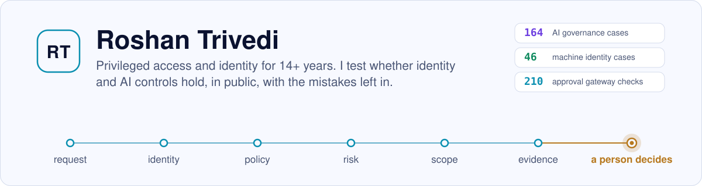

<picture>
  <source media="(prefers-color-scheme: dark)" srcset="assets/header-dark.svg">
  
</picture>

  
  
  
  

I own a credential management platform and have spent 14+ years in privileged access, credentials and non-human identity. On my own time I build small labs that check whether identity and AI controls hold when you try to break them. I write my guess down before the code, switch each control off to see if anything notices, and keep the results where my guesses were wrong.

## Three labs, one method

| Lab | What I tested | What I found | Open |
|---|---|---|---|
| **AI Governance Lab** | 13 rounds, 164 cases: an agent calling an identity API, HR-driven joiners and leavers, an assistant reading company documents, delegation and keys | Telling a model "do not reveal this" changed nothing. Checking live permissions before fetching held. My own checker lied once, and I kept the file. | [Code](https://github.com/trivediroshan1-ui/ai-governance-lab) · [Read it](https://roshantrivedi.co.in/ai-governance-lab/?utm_source=github&utm_medium=profile) |
| **Machine identity lab** | 46 cases on service accounts, API keys, CI tokens, break-glass accounts and AI tools with their own logins | 42 guesses matched and 4 were wrong. In 8 cases a control sat there and nothing noticed it was off. | [Read it](https://roshantrivedi.co.in/nhi-lab/?utm_source=github&utm_medium=profile) |
| **MCP approval gateway** | A gateway that holds risky AI agent tool calls for a person, ties each approval to one exact request and logs every decision in a hash chain. 210 scripted checks. | The gate held against changed and reused requests. The weak point was me: I approved 40 production deploys in under half a second, with the same reason each time. | [Code](https://github.com/trivediroshan1-ui/mcp-human-approval-gateway) · [Case study](https://roshantrivedi.co.in/mcp-lab-case-study/?utm_source=github&utm_medium=profile) |

<picture>
  <source media="(prefers-color-scheme: dark)" srcset="assets/lab-method-dark.svg">
  
</picture>

<table>
<tr>
<td valign="top" width="50%">

### Latest writing

<!-- writing:start -->
- [I Tested 46 Non-Human Identity Cases. My Guesses Were Wrong in Four.](https://roshantrivedi.co.in/writing/non-human-identity-lab-46-cases/?utm_source=github&utm_medium=profile) 03 Nov 2026
- [From Permanent Admin Rights to Zero Standing Privilege: A Practical PAM Modernization Path](https://roshantrivedi.co.in/writing/pam-modernization-and-zero-standing-privilege/?utm_source=github&utm_medium=profile) 29 Oct 2026
- [Can a Person Stay in Control of an AI Agent? I Tried to Break an Approval Gate 210 Ways](https://roshantrivedi.co.in/writing/can-a-person-stay-in-control-of-an-ai-agent/?utm_source=github&utm_medium=profile) 29 Oct 2026
- [Do AI Governance Controls Hold? What I Found in 13 Rounds and 164 Cases](https://roshantrivedi.co.in/writing/do-ai-governance-controls-hold/?utm_source=github&utm_medium=profile) 29 Oct 2026
- [PAM as an Identity: What Changes When the Vault Can Talk to Your Governance System](https://roshantrivedi.co.in/writing/pam-as-an-identity/?utm_source=github&utm_medium=profile) 10 Oct 2026
<!-- writing:end -->

Refreshed daily from the site's feed.

</td>
<td valign="top" width="50%">

### Free to read

- **Who Approved That?** The MCP lab as a book, 138 pages. [Read](https://roshantrivedi.co.in/book/?utm_source=github&utm_medium=profile)
- **Does AI Governance Hold?** 69 pages. [PDF](https://roshantrivedi.co.in/assets/ai-governance-lab-book.pdf)
- **Rounds five to thirteen.** 74 pages. [PDF](https://roshantrivedi.co.in/assets/ai-governance-lab-addendum.pdf)

### Also on the site

- [22 case studies](https://roshantrivedi.co.in/case-studies/?utm_source=github&utm_medium=profile) on privileged access, credentials and agent identity
- [Credential tiering self-check](https://roshantrivedi.co.in/tools/tier-check/?utm_source=github&utm_medium=profile): where would one stolen credential stop? Three minutes, runs in your browser.
- [Talks and workshops](https://roshantrivedi.co.in/speaking/?utm_source=github&utm_medium=profile) built on the labs

</td>
</tr>
</table>

## What I work on

Privileged access (PAM) · identity governance (IAM, IGA) · non-human identity and secrets · AI agents and MCP security · audit and control mapping against NIST 800-53, ISO 27001, PCI DSS and HIPAA.

## Limits

Small models I wrote, made-up data and no real tenant yet. I wrote both the guesses and the code, so the cases that matter most are the ones other people add. If you see a weak test, [propose a case](https://github.com/trivediroshan1-ui/ai-governance-lab/issues/new/choose).

All data in these labs is made up. Nothing here relates to any employer or real company.
