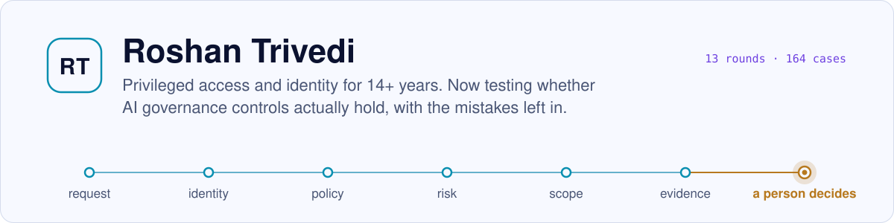

<picture>
  <source media="(prefers-color-scheme: dark)" srcset="assets/header-dark.svg">
  
</picture>

Credential management platform owner. 14+ years in privileged access, credentials and non-human identity. Now testing whether AI governance controls actually hold, in public, with the mistakes left in.

### Start here

| | What it is | Open |
|---|---|---|
| **AI Governance Lab** | 13 rounds, 164 cases on made-up data. For every case I write what I expect, hash it (SHA-256) and commit it before the code, run it, then switch each control off to see if a check notices. | [Repository](https://github.com/trivediroshan1-ui/ai-governance-lab) · [Read it, with videos](https://roshantrivedi.co.in/ai-governance-lab/?utm_source=github&utm_medium=profile) · [Every Mac command, with output](https://roshantrivedi.co.in/ai-governance-lab/mac/?utm_source=github&utm_medium=profile) |
| **MCP human-approval gateway** | A small gateway that holds risky AI-agent tool calls for a person, ties the approval to one exact request, and logs every decision in a hash chain. Synthetic tools only. | [Repository](https://github.com/trivediroshan1-ui/mcp-human-approval-gateway) |

<picture>
  <source media="(prefers-color-scheme: dark)" srcset="assets/lab-method-dark.svg">
  
</picture>

### Free to read

- **Does AI Governance Hold?** Book, 69 pages. [PDF](https://roshantrivedi.co.in/assets/ai-governance-lab-book.pdf)
- **Who Approved That?** Book, 138 pages. [Read](https://roshantrivedi.co.in/book/?utm_source=github&utm_medium=profile)
- **Rounds five to thirteen.** 74 pages. [PDF](https://roshantrivedi.co.in/assets/ai-governance-lab-addendum.pdf)

### What I work on

Privileged access (PAM) · identity governance (IAM, IGA) · non-human identity and secrets · AI agents and MCP security · audit and control mapping against NIST 800-53, ISO 27001, PCI DSS and HIPAA.

### Limits

Small models, made-up data, no real tenant yet, and I wrote both the guesses and the code. If you see a weak test, [propose a case](https://github.com/trivediroshan1-ui/ai-governance-lab/issues/new/choose).

---

[roshantrivedi.co.in](https://roshantrivedi.co.in/?utm_source=github&utm_medium=profile) · [LinkedIn](https://www.linkedin.com/in/roshan-trivedi-ciam/) · Bengaluru, India

All data is made up. Nothing here relates to any employer or real company.
