<picture>
  <source media="(prefers-color-scheme: dark)" srcset="assets/header-dark.svg">
  
</picture>

  
  
  
  

I own a credential management platform and have spent 14+ years in privileged access, credentials and non-human identity. On my own time I build small labs that check whether identity and AI controls hold when you try to break them. I write my guess down before the code, switch each control off to see if anything notices, and keep the results where my guesses were wrong.

## Four labs, one method

| Lab | What I tested | What I found | Open |
|---|---|---|---|
| **Conditional access, MFA and AI agent lab** | 130 cases along the access chain: enrolment and recovery, MFA, single sign-on, conditional access rules, and how AI agents and MCP tools sign in and keep access | MFA alone does not hold: a weak link anywhere lets the attacker through. 124 cases run, 6 guesses wrong. | [Read it](https://roshantrivedi.co.in/ca-mfa-lab/?utm_source=github&utm_medium=profile) · [Run it in your browser](https://roshantrivedi.co.in/ca-mfa-lab/virtual-lab/?utm_source=github&utm_medium=profile) |
| **AI Governance Lab** | 13 rounds, 164 cases: an agent calling an identity API, HR-driven joiners and leavers, an assistant reading company documents, delegation and keys | Telling a model "do not reveal this" changed nothing. Checking live permissions before fetching held. My own checker lied once, and I kept the file. | [Code](https://github.com/trivediroshan1-ui/ai-governance-lab) · [Read it](https://roshantrivedi.co.in/ai-governance-lab/?utm_source=github&utm_medium=profile) |
| **Machine identity lab** | 67 cases on service accounts, API keys, CI tokens, break-glass accounts and AI tools with their own logins | 57 guesses matched and 10 were wrong. In 20 cases a control sat there and nothing noticed it was off. | [Read it](https://roshantrivedi.co.in/nhi-lab/?utm_source=github&utm_medium=profile) · [The book on the web](https://roshantrivedi.co.in/nhi-lab/book/?utm_source=github&utm_medium=profile) |
| **MCP approval gateway** | A gateway that holds risky AI agent tool calls for a person, ties each approval to one exact request and logs every decision in a hash chain. 210 scripted checks. | The gate held against changed and reused requests. The weak point was me: I approved 40 production deploys in under half a second, with the same reason each time. | [Code](https://github.com/trivediroshan1-ui/mcp-human-approval-gateway) · [Read it](https://roshantrivedi.co.in/mcp-lab/?utm_source=github&utm_medium=profile) |

<picture>
  <source media="(prefers-color-scheme: dark)" srcset="assets/results-dark.svg">
  
</picture>

Every case from all four labs is in [one filterable list](https://roshantrivedi.co.in/labs/cases/?utm_source=github&utm_medium=profile), and the whole site is [searchable](https://roshantrivedi.co.in/search/?utm_source=github&utm_medium=profile).

<picture>
  <source media="(prefers-color-scheme: dark)" srcset="assets/lab-method-dark.svg">
  
</picture>

<table>
<tr>
<td valign="top" width="50%">

### Latest writing

<!-- writing:start -->
- [Break Glass: Eight Ways to Build It, and What to Do When the Tool Is the Thing That Is Down](https://roshantrivedi.co.in/writing/break-glass-eight-ways/?utm_source=github&utm_medium=profile) 20 Nov 2026
- [A Break-Glass Architecture, Tested: Six Cases and One Wrong Guess About the Drill](https://roshantrivedi.co.in/writing/break-glass-architecture-tested/?utm_source=github&utm_medium=profile) 20 Nov 2026
- [I Tested 130 Conditional Access, MFA and AI Agent Cases. Six of My Guesses Were Wrong.](https://roshantrivedi.co.in/writing/130-conditional-access-mfa-and-ai-agent-cases/?utm_source=github&utm_medium=profile) 14 Nov 2026
- [I Tested 67 Machine Identity Cases. Here Is Where the Controls Stopped.](https://roshantrivedi.co.in/writing/i-tested-67-machine-identity-cases/?utm_source=github&utm_medium=profile) 11 Nov 2026
- [I Ran the 19 Cases I Had Been Putting Off. Five Guesses Were Wrong.](https://roshantrivedi.co.in/writing/non-human-identity-lab-round-19/?utm_source=github&utm_medium=profile) 10 Nov 2026
<!-- writing:end -->

Refreshed daily from the site's feed.

</td>
<td valign="top" width="50%">

### Free to read

- **Who signs in?** The conditional access, MFA and AI agent lab, 72 pages. [PDF](https://roshantrivedi.co.in/ca-mfa-lab/ca-mfa-lab-book.pdf)
- **Machine identities, tested in public.** 83 pages. [Read on the web](https://roshantrivedi.co.in/nhi-lab/book/?utm_source=github&utm_medium=profile) · [PDF](https://roshantrivedi.co.in/nhi-lab/nhi-lab-book.pdf)
- **Does AI Governance Hold?** 71 pages. [PDF](https://roshantrivedi.co.in/assets/ai-governance-lab-book.pdf)
- **Rounds five to thirteen.** 76 pages. [PDF](https://roshantrivedi.co.in/assets/ai-governance-lab-addendum.pdf)
- **Who Approved That?** The MCP lab as a book, 138 pages. [Read](https://roshantrivedi.co.in/book/?utm_source=github&utm_medium=profile)

### Also on the site

- [22 case studies](https://roshantrivedi.co.in/case-studies/?utm_source=github&utm_medium=profile) on privileged access, credentials and agent identity
- [Credential tiering self-check](https://roshantrivedi.co.in/tools/tier-check/?utm_source=github&utm_medium=profile): where would one stolen credential stop? Three minutes, runs in your browser.
- [Talks and workshops](https://roshantrivedi.co.in/speaking/?utm_source=github&utm_medium=profile) built on the labs
- [The library](https://roshantrivedi.co.in/library/?utm_source=github&utm_medium=profile): every page, by subject

</td>
</tr>
</table>

## What I work on

Privileged access (PAM) · identity governance (IAM, IGA) · sign-in, MFA and conditional access · non-human identity and secrets · AI agents and MCP security · audit and control mapping against NIST 800-53, ISO 27001, PCI DSS and HIPAA.

## Limits

Small models I wrote, made-up data and no real tenant yet. I wrote both the guesses and the code, so the cases that matter most are the ones other people add. If you see a weak test, [propose a case](https://github.com/trivediroshan1-ui/ai-governance-lab/issues/new/choose).

All data in these labs is made up. Nothing here relates to any employer or real company.
